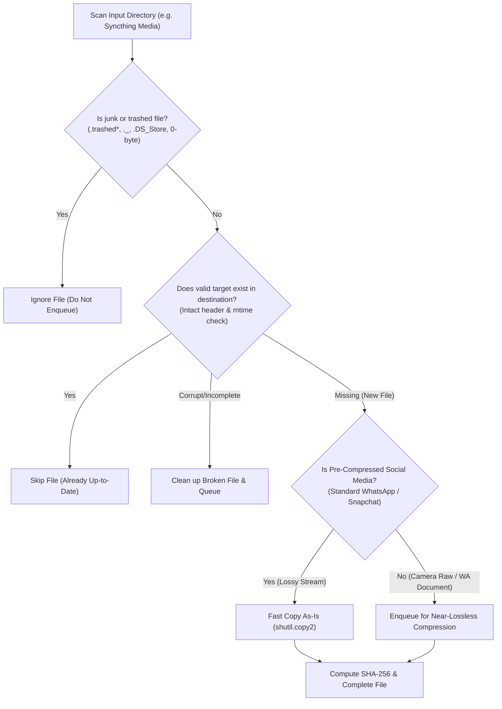

<p align="center">
  
</p>

# MediaCompressorWebApp

[](VERSION)
[](LICENSE)
[](https://www.python.org/)
[](https://flask.palletsprojects.com/)

**MediaCompressorWebApp** is a self-hosted Flask web application and background worker queue for batch-compressing local image and video directories. It processes files concurrently using a multiprocessing worker pool for images (Pillow) and a multithreaded worker pool for videos (FFmpeg), tracking job progress, per-file metrics, and SHA-256 digests in an embedded SQLite database.

---

## Workflow & Incremental Sync Architecture



---

## Intended Use & Tradeoffs

### Who It Is For
- Users who need a local, offline web interface or REST API to compress folders of media files without third-party cloud services.
- Workflows syncing media from mobile devices (e.g. via Syncthing) into permanent archival storage where repeated runs only compress newly arrived files.
- Workflows requiring structured JSON audit manifests containing file-level SHA-256 checksums and byte reductions.
- Systems that benefit from automatic CPU/RAM resource scaling and hardware-accelerated video encoding where supported.

### Who It Is Not For
- **Multi-user or untrusted network environments**: The application has no authentication, user authorization, or path sandboxing. Anyone with access to the web interface or API can initiate jobs reading or writing any filesystem location accessible to the server process, or clear database history.

---

## Verified System Requirements

| Component | Minimum Version | Verified Version | Notes |
|-----------|-----------------|------------------|-------|
| **Python** | 3.10+ | 3.14.10 / 3.15 | Requires C-extension support for dependencies (Pillow, greenlet, eventlet). |
| **FFmpeg** | 4.x+ | 7.x (with ffprobe) | Required for video compression. Must be available in system `PATH`. |
| **Pillow** | 10.0+ | 12.3.0 | Installed via `requirements.txt`. Sole image backend. (ImageMagick is not used). |
| **pillow-heif** | 0.16+ | 1.4.0 | Required for HEIC image decoding. |
| **Database** | SQLite 3.25+ | 3.43+ | Bundled with Python standard library. Uses `WAL` mode and window functions. |

---

## Installation

### 1. Clone the repository

```bash
git clone https://github.com/viruchith/MediaCompressorWebApp.git
cd MediaCompressorWebApp
```

### 2. Create and activate a virtual environment

```bash
python3 -m venv .venv
source .venv/bin/activate
```

### 3. Install dependencies

```bash
# Core runtime dependencies
pip install -r requirements.txt

# (Optional) Development and testing dependencies
pip install -r requirements-dev.txt
```

### 4. Verify FFmpeg installation

```bash
ffmpeg -version
```

If not installed:
- **macOS**: `brew install ffmpeg`
- **Ubuntu/Debian**: `sudo apt update && sudo apt install ffmpeg`
- **Windows**: Download official binaries from [ffmpeg.org](https://ffmpeg.org/download.html) and add the directory containing `ffmpeg.exe` to system `PATH`.

---

## Quick Start

### 1. Configure environment (recommended)

Copy `config.env.example` to `.env`. For local security, keep `HOST=127.0.0.1`:

```bash
cp config.env.example .env
```

### 2. Run the application

```bash
python run.py
```

Expected startup output:
```
[INFO] app.hardware: Hardware detected: darwin arm64 | CPU: Apple M4 (10/10 cores) | RAM: 24.0 GB | GPU: Apple M4 (apple)
[INFO] app.hardware: Recommendations: image_workers=8, video_workers=3, codec=hevc_videotoolbox, hw_accel=True
[INFO] app.factory: Hardware profile initialized: hevc_videotoolbox
[INFO] app.workers.manager: Worker manager started (images=8 [process pool], videos=3 [thread pool])
[INFO] __main__: Starting MediaCompressorWebApp on 127.0.0.1:5000
```

Open **http://127.0.0.1:5000** in your browser.

---

## Configuration Reference

The application reads configuration from environment variables (or `.env` file via `python-dotenv`).

| Variable | Default | Type | Description | Source |
|----------|---------|------|-------------|--------|
| `HOST` | `0.0.0.0` | string | Network interface bind address. Change to `127.0.0.1` for local safety. | `app/config.py:29` |
| `PORT` | `5000` | int | TCP port for web UI and REST API. | `app/config.py:30` |
| `SECRET_KEY` | `dev-secret-key-change-in-production` | string | Flask session secret key. | `app/config.py:11` |
| `DB_PATH` | `file_db.db` | string | SQLite database file location. | `app/config.py:12` |
| `AUTO_SCALE` | `true` | bool | When true, overrides static worker counts using detected CPU and RAM. | `app/config.py:21` |
| `WORKER_COUNT_IMAGES` | `4` | int | Parallel image worker processes (used if `AUTO_SCALE=false`). | `app/config.py:13` |
| `WORKER_COUNT_VIDEOS` | `2` | int | Parallel video worker threads (used if `AUTO_SCALE=false`). | `app/config.py:14` |
| `MIN_FREE_DISK_MB` | `100` | int | Minimum free MB on target disk required before dispatching a file. | `app/config.py:19` |
| `PROCESSING_TIMEOUT_MINUTES` | `30` | int | Watchdog marks in-flight files timed out after N minutes without completion. | `app/config.py:16` |
| `MAX_RETRIES` | `3` | int | Maximum retry attempts per file before permanent failure (`status=-2`). | `app/config.py:15` |
| `LOG_LEVEL` | `INFO` | string | Logging verbosity (`DEBUG`, `INFO`, `WARNING`, `ERROR`). | `app/config.py:24` |
| `LOG_FILE` | `logs/app.log` | string | Rotating file log path (empty string disables file logging). | `app/config.py:26` |
| `LOG_MAX_BYTES` | `10485760` | int | Max size per log file before rotation (default: 10 MB). | `app/config.py:27` |
| `LOG_BACKUP_COUNT` | `5` | int | Number of rotated log archives to keep. | `app/config.py:28` |
| `LOG_JSON` | `false` | bool | Output structured JSON log format to handlers. | `app/config.py:25` |
| `HW_ACCEL_MODE` | `auto` | string | *Note*: Defined in `Config`, but not currently referenced in worker selection. | `app/config.py:23` |

---

## Compression Profiles & Measured Parameters

The system defines 6 profiles in [`app/compression/profiles.py`](app/compression/profiles.py). Below are the exact codec arguments applied and measured results on test fixtures.

### Profile Definitions

| Profile | Image Settings | Video Settings |
|---------|----------------|----------------|
| `archival_lossless` | PNG, 100% quality, `lossless=True`, metadata kept | `libx265`, CRF 0, preset `veryslow`, container `mkv`, audio `copy` |
| `archival_visually_lossless` | WebP, 95% quality, metadata kept | `libx265`, CRF 18, preset `slow`, container `mkv`, audio `aac` 192k |
| `balanced` *(Default)* | WebP, 75% quality, metadata kept | `libx265`, CRF 28, preset `slow`, container `mkv`, audio `aac` 128k |
| `web_optimized` | WebP, 60% quality, max 1920px, metadata stripped | `libx264`, CRF 23, preset `medium`, container `mp4`, audio `aac` 128k |
| `mobile_friendly` | WebP, 70% quality, max 1080px, metadata stripped | `libx264`, CRF 28, preset `medium`, scale `720p` (`1280:-2`), container `mp4`, audio `aac` 96k |
| `maximum_compression` | WebP, 40% quality, max 1920px, metadata stripped | `libx265`, CRF 35, preset `veryslow`, scale `720p` (`1280:-2`), container `mkv`, audio `opus` 64k *(Known issue: see below)* |

### Measured Behavior on Test Media
Observed on synthetic fixtures (2000×1500 PNG test pattern, 1920×1080 30fps 2s H.264 video):
- **Images**:
  - `archival_lossless`: 13.6 KB → 12.3 KB PNG (91% of original).
  - `archival_visually_lossless`: 13.6 KB → 30.3 KB WebP (223% of original). High-quality lossy WebP (q=95) on structured graphics can exceed compressed source PNGs.
  - `balanced`: 13.6 KB → 15.0 KB WebP.
  - `web_optimized`: 13.6 KB → 10.5 KB WebP (scaled to 1920×1440).
  - `mobile_friendly`: 13.6 KB → 1.8 KB WebP (scaled to 1080×810).
  - `maximum_compression`: 13.6 KB → 8.2 KB WebP.
- **Videos**:
  - `archival_lossless`: 65.7 KB → 383.2 KB HEVC MKV (583% of original, CRF 0 creates uncompressed intra/predictive frames).
  - `archival_visually_lossless`: 65.7 KB → 101.6 KB HEVC MKV.
  - `balanced`: 65.7 KB → 66.8 KB HEVC MKV.
  - `web_optimized`: 65.7 KB → 79.9 KB H.264 MP4.
  - `mobile_friendly`: 65.7 KB → 47.1 KB H.264 MP4 (scaled to 1280×720).
  - `maximum_compression`: Fails on standard FFmpeg due to native experimental Opus codec error (`FFmpeg failed with code 88`). See [docs/KNOWN_ISSUES.md](docs/KNOWN_ISSUES.md).

---

## Behavior on Re-runs, Deletions, and Re-compression

1. **Incremental Processing & Re-runs**:
   - The application checks the destination output folder dynamically during file scanning.
   - If an output file already exists, is non-empty, passes structural integrity tests (via Pillow or ffprobe), and matches source modification timestamps, it is **skipped automatically**.
   - Subsequent runs on the same source and destination folders only process newly added files.
   - Deleting the job or losing the SQLite database does **not** cause re-compression of already archived media, as the destination folder is the source of truth.
2. **Interrupted Job Recovery**:
   - If a previous compression job was terminated mid-transcode, leaving a partial or zero-byte output file, the scanner detects the invalid header/container, deletes the corrupted artifact, and schedules it for clean re-compression.
3. **Social Media & WhatsApp Document Handling**:
   - Pre-compressed media from WhatsApp (`IMG-*-WA*`, `VID-*-WA*`, `WhatsApp Images/Video`) and Snapchat is copied directly to the archive destination without re-encoding to prevent generational degradation.
   - Media sent as an uncompressed WhatsApp Document (`WhatsApp Documents/` or media containing original camera EXIF and high bitrates) is recognized as camera original and compressed using the selected profile.
4. **Queue actions**:
   - `POST /api/v1/clear_completed`: Deletes records with `status=1` (completed) from SQLite. Files on disk are retained.
   - `POST /api/v1/cancel_queue`: Cancels active/pending files in SQLite (`status=-3`) and terminates tracked running FFmpeg subprocesses.
   - `POST /api/v1/clear_history`: Terminates active work, resets queue, and flushes database tables. Output files on disk are never deleted.

---

## Metadata and Checksum Verification

- **EXIF & Color Profiles (Images)**:
  - Preserved on WebP and JPEG when `strip_metadata=False` (default for `archival_*` and `balanced`).
  - Stripped when `strip_metadata=True` (`web_optimized`, `mobile_friendly`, `maximum_compression`).
  - XMP image metadata is not explicitly transferred by Pillow.
- **Video Container Metadata**:
  - `-map_metadata 0` is passed to FFmpeg, copying container-level tags (e.g. title, creation date, artist).
- **Filesystem Modification Time (`mtime`)**:
  - Preserved on direct copies (`copy_as_is`); transcoding creates new files with current timestamps.
- **SHA-256 Checksums**:
  - Streaming SHA-256 digests are computed in 1 MB chunks over source and target files and recorded in the JSON manifest.

---

## Security & Deployment Warnings

> [!CAUTION]
> **No Authentication**: MediaCompressorWebApp has NO authentication, password protection, or API tokens.

- **Network Exposure**: By default, `Config.HOST` is set to `0.0.0.0`, allowing any device on your local network to access the web UI and REST API. If running on an untrusted or public network, configure `HOST=127.0.0.1` in `.env`.
- **Arbitrary Path Access**: `POST /api/v1/jobs` accepts arbitrary paths for `input_folder` and `output_folder`.
- **Recommended Production Topology**:
  - Bind the application to `127.0.0.1:5000`.
  - Put a reverse proxy (e.g., Nginx, Caddy, Cloudflare Tunnel) in front with HTTP Basic Authentication or OAuth2.

---

## Platform Support Matrix

| Platform | Verification Status | Notes |
|----------|---------------------|-------|
| **macOS (Apple Silicon)** | **VERIFIED** | Tested on M4 macOS 15. Probes CPU topology, RAM, and `videotoolbox` hardware encoding (`hevc_videotoolbox`, `h264_videotoolbox`). |
| **Linux (x86_64 / ARM)** | **PARTIAL** | Detection logic implemented for `/proc/cpuinfo`, `/proc/meminfo`, and NVIDIA/Intel/AMD devices. Unit tests pass (mocked). Physical hardware encoding on NVENC/QSV/AMF is unverified on this host. |
| **Windows** | **PARTIAL** | Detection logic implemented using `wmic`. Unit tests pass (mocked). Physical Windows environment unverified. |

---

## Running Tests

Unit tests are managed via `pytest` and defined under `tests/`:

```bash
# Ensure development dependencies are installed
pip install -r requirements-dev.txt

# Run full test suite
pytest -v
```

Observed test run:
```
collected 86 items
tests/test_api.py .............                                          [ 15%]
tests/test_db.py ........                                                [ 24%]
tests/test_hardware.py ................................................. [ 81%]
tests/test_incremental_archive.py ....                                   [ 86%]
tests/test_scanner.py ...                                                [ 89%]
tests/test_utils.py .........                                            [100%]
============================== 86 passed in 4.47s ==============================
```

---

## Known Limitations

For reproduction steps and severity rankings, see [`docs/KNOWN_ISSUES.md`](docs/KNOWN_ISSUES.md):
1. **Opus Audio Encoding**: The `maximum_compression` video profile defaults to native Opus audio, which fails with code 88 on standard FFmpeg builds without `-strict -2`.
2. **Dead Configuration**: `HW_ACCEL_MODE` in `.env` is parsed but ignored by the worker selection engine.
3. **Poison File Handling**: `is_poison_file()` helper is implemented in `app/db.py` but is not wired into the worker dispatch loop.

---

## License

This software is licensed under the **GNU General Public License v3.0**. See the [LICENSE](LICENSE) file for details.
