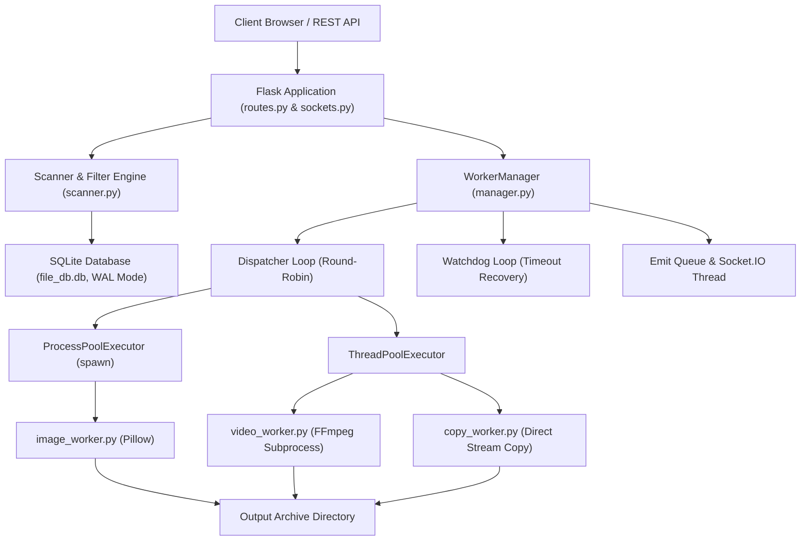
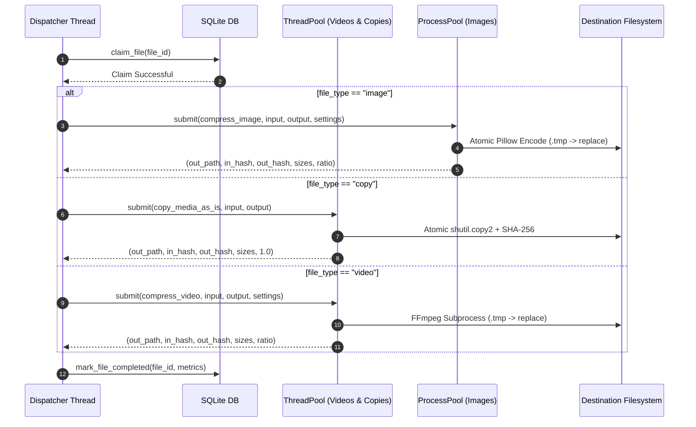
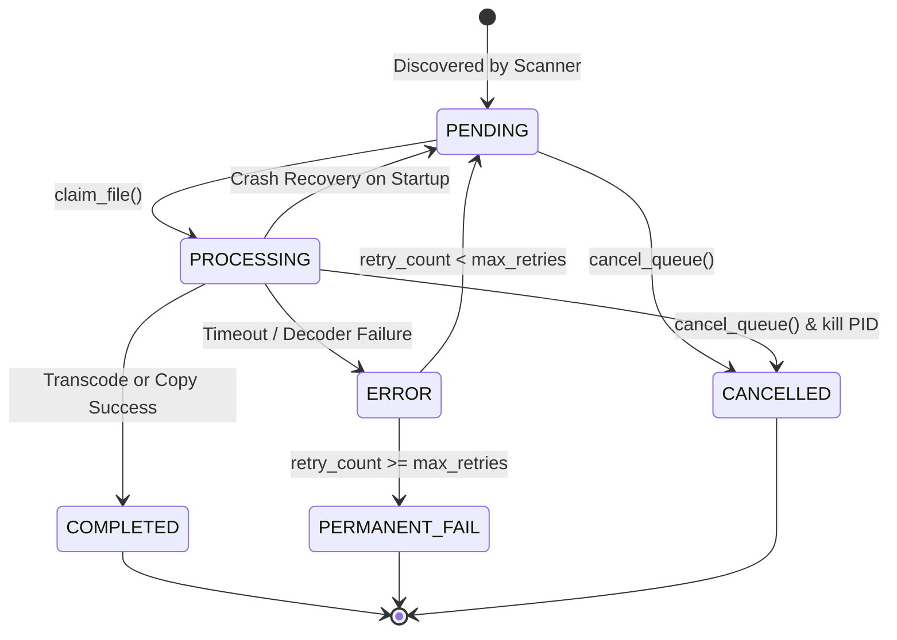
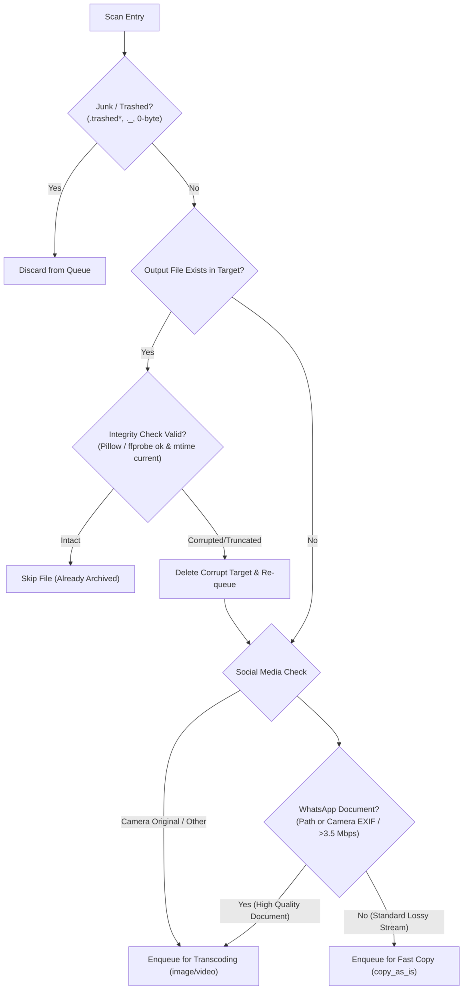

# Technical Documentation & System Architecture

> In-depth architectural specification, data model, concurrency topology, and runtime behavior for **MediaCompressorWebApp** v2.6.0.

---

## 1. System Architecture & Module Map

```
MediaCompressorWebApp/
├── run.py                          # Application entry point; initializes DB, app factory, and web server
├── VERSION                         # Version string (2.6.0) loaded by app/version.py
├── app/
│   ├── config.py                   # Dataclass loading environment variables with defaults
│   ├── factory.py                  # Flask app factory, logging configuration, signal handlers
│   ├── hardware.py                 # Cross-platform CPU/RAM/GPU detection and adaptive worker sizing
│   ├── db.py                       # SQLite connection lifecycle, schema migrations, and queue operations
│   ├── routes.py                   # Web routes and REST API v1 endpoints
│   ├── sockets.py                  # WebSocket connection and client-initiated request handlers
│   ├── models.py                   # Data transfer objects: Job, FileRecord, PaginatedResult
│   ├── compression/
│   │   ├── profiles.py             # Predefined image and video compression presets
│   │   └── settings.py             # Validation and parameter merging for image and video codecs
│   ├── workers/
│   │   ├── manager.py              # WorkerManager orchestrator: dispatcher, watchdog, emit queue
│   │   ├── image_worker.py         # Pillow image compression executed in worker process
│   │   ├── video_worker.py         # FFmpeg video compression executed in worker thread
│   │   ├── copy_worker.py          # Fast streaming shutil.copy2 for pre-compressed media
│   │   └── process_registry.py     # Registry tracking running FFmpeg subprocess PIDs
│   └── utils/
│       ├── scanner.py              # Filtering junk, integrity checks, and social media classification
│       ├── hashing.py              # Streaming SHA-256 chunked calculation with abort checks
│       └── manifest.py             # Job manifest JSON generator and file export
```

### Architectural Component Diagram



### Verified Module Roles

| Module | Source Reference | Verified Implementation |
|--------|------------------|-------------------------|
| `app/config.py` | [config.py:9-49](file:///Users/viruchith/Projects/MediaCompressorWebApp/app/config.py#L9-L49) | Loads `.env` via `python-dotenv`. Declares all runtime constants and limits. |
| `app/factory.py` | [factory.py:65-156](file:///Users/viruchith/Projects/MediaCompressorWebApp/app/factory.py#L65-L156) | Registers blueprints (`api_bp` at `/api/v1`, `web_bp` at root), initializes hardware caching, attaches signal traps for SIGTERM/SIGINT. |
| `app/hardware.py` | [hardware.py:1-719](file:///Users/viruchith/Projects/MediaCompressorWebApp/app/hardware.py#L1-L719) | Probes sysctl/proc/wmic and `ffmpeg -encoders` at startup. Calculates recommended worker pools. |
| `app/db.py` | [db.py:67-150](file:///Users/viruchith/Projects/MediaCompressorWebApp/app/db.py#L67-L150) | SQLite engine operating in WAL mode with connection-per-thread (`threading.local`). Implements round-robin queue fetching. |
| `app/routes.py` | [routes.py:206-260](file:///Users/viruchith/Projects/MediaCompressorWebApp/app/routes.py#L206-L260) | Background scanner with destination integrity check and social media classification. |
| `app/utils/scanner.py` | [scanner.py:1-215](file:///Users/viruchith/Projects/MediaCompressorWebApp/app/utils/scanner.py#L1-L215) | Filters `.trashed*` and OS junk, runs structural image/video integrity tests, and classifies WhatsApp Documents vs lossy streams. |
| `app/workers/copy_worker.py` | [copy_worker.py:1-68](file:///Users/viruchith/Projects/MediaCompressorWebApp/app/workers/copy_worker.py#L1-L68) | Streaming direct file copy preserving source `mtime` and computing SHA-256 checksums. |
| `app/workers/manager.py` | [manager.py:30-80](file:///Users/viruchith/Projects/MediaCompressorWebApp/app/workers/manager.py#L30-L80) | Manages executors, watchdog loop, copy tasks, and Socket.IO emit bridge. |
| `app/workers/image_worker.py` | [image_worker.py:38-140](file:///Users/viruchith/Projects/MediaCompressorWebApp/app/workers/image_worker.py#L38-L140) | Opens images with Pillow and `pillow-heif`, strips/preserves EXIF/ICC, writes atomic temporary files. |
| `app/workers/video_worker.py` | [video_worker.py:62-170](file:///Users/viruchith/Projects/MediaCompressorWebApp/app/workers/video_worker.py#L62-L170) | Builds FFmpeg command lines, invokes `subprocess.Popen`, registers PID, parses progress, handles HW-to-SW fallback. |

---

## 2. Concurrency & Execution Model

The application splits concurrency into dedicated execution pools inside `WorkerManager`:



---

## 3. Data Model & Database Schema

The database is an embedded SQLite file (`file_db.db`) configured on every thread connection with:
```sql
PRAGMA journal_mode = WAL;
PRAGMA foreign_keys = ON;
```

### Schema (`SCHEMA_V1`)

#### `jobs` Table
Stores high-level batch job metadata and tracking counters.

| Column | Type | Constraints | Description |
|--------|------|-------------|-------------|
| `id` | `INTEGER` | `PRIMARY KEY AUTOINCREMENT` | Unique job identifier |
| `input_folder` | `TEXT` | `NOT NULL` | Absolute or relative input folder path |
| `output_folder` | `TEXT` | `NOT NULL` | Absolute or relative output folder path |
| `image_settings` | `TEXT` | `NOT NULL DEFAULT '{}'` | JSON string of effective image compression parameters |
| `video_settings` | `TEXT` | `NOT NULL DEFAULT '{}'` | JSON string of effective video compression parameters |
| `profile` | `TEXT` | `NULL` | Legacy unified profile name if image & video match |
| `image_profile` | `TEXT` | `NULL` | Assigned image profile name |
| `video_profile` | `TEXT` | `NULL` | Assigned video profile name |
| `status` | `TEXT` | `NOT NULL DEFAULT 'active'` | Job lifecycle status (`active`, `paused`, `completed`, `cancelled`, `scan_failed`) |
| `total_files` | `INTEGER` | `DEFAULT 0` | Total files discovered during folder scan |
| `completed_files` | `INTEGER` | `DEFAULT 0` | Files successfully compressed |
| `failed_files` | `INTEGER` | `DEFAULT 0` | Files hitting permanent failure |
| `cancelled_files` | `INTEGER` | `DEFAULT 0` | Files cancelled by queue cancel |
| `created_at` | `TIMESTAMP` | `DEFAULT CURRENT_TIMESTAMP` | Job creation timestamp (UTC) |
| `completed_at` | `TIMESTAMP` | `NULL` | Timestamp when final file completed |

#### `files` Table
Stores individual file queue records and compression metrics.

| Column | Type | Constraints | Description |
|--------|------|-------------|-------------|
| `id` | `INTEGER` | `PRIMARY KEY AUTOINCREMENT` | Unique file record identifier |
| `job_id` | `INTEGER` | `NOT NULL REFERENCES jobs(id)` | Foreign key linking to parent job |
| `input_file_path` | `TEXT` | `NOT NULL UNIQUE` | Full path to source media file |
| `output_file_path` | `TEXT` | `NULL` | Path where compressed output file is written |
| `file_type` | `TEXT` | `NOT NULL` | `'image'`, `'video'`, or `'copy'` |
| `status` | `INTEGER` | `NOT NULL DEFAULT 0` | Integer status code |
| `priority` | `INTEGER` | `DEFAULT 0` | Higher values claim first |
| `retry_count` | `INTEGER` | `DEFAULT 0` | Incremented upon error or timeout |
| `max_retries` | `INTEGER` | `DEFAULT 3` | Maximum attempts allowed before permanent fail |
| `error_message` | `TEXT` | `NULL` | Last error string captured from exception/FFmpeg |
| `input_size` | `INTEGER` | `NULL` | Original source size in bytes |
| `output_size` | `INTEGER` | `NULL` | Compressed output size in bytes |
| `input_hash` | `TEXT` | `NULL` | Streaming SHA-256 hex digest of source file |
| `output_hash` | `TEXT` | `NULL` | Streaming SHA-256 hex digest of output file |
| `compression_ratio` | `REAL` | `NULL` | `output_size / input_size` |
| `started_at` | `TIMESTAMP` | `NULL` | Timestamp when worker claimed file |
| `completed_at` | `TIMESTAMP` | `NULL` | Timestamp when worker finalized file |
| `created_at` | `TIMESTAMP` | `DEFAULT CURRENT_TIMESTAMP` | Enqueue timestamp |

---

## 4. File State Machine & Transitions



---

## 5. Incremental Archival & Social Media Pipeline

The application features a stateless sync pipeline designed for folder sync solutions like Syncthing:



---

## 6. Hardware Auto-Detection & Codec Execution

Hardware capabilities are inspected once during app creation (`app/hardware.py:initialize()`).

### Detection Mechanisms by OS
- **macOS**:
  - CPU: Runs `/usr/sbin/sysctl -n machdep.cpu.brand_string`, `hw.physicalcpu`, `hw.logicalcpu`, `hw.perflevel0.logicalcpu`.
  - RAM: Runs `/usr/sbin/sysctl -n hw.memsize` and parses page allocations from `/usr/bin/vm_stat`.
  - GPU: Parses `/usr/sbin/system_profiler SPDisplaysDataType -detailLevel mini`.
- **Linux**:
  - CPU: Parses `/proc/cpuinfo`.
  - RAM: Parses `/proc/meminfo` (`MemTotal`, `MemAvailable`).
  - GPU: Searches for `nvidia-smi`, checks `/sys/class/drm/card*/device/vendor`.
- **Windows**:
  - Runs `wmic cpu`, `wmic computersystem get totalphysicalmemory`, `wmic path win32_VideoController`.

### FFmpeg Hardware Flag Generation

| Target HW Codec | FFmpeg Input Flag (before `-i`) | Quality Flag | Default Value | Extra Flags |
|-----------------|---------------------------------|--------------|---------------|-------------|
| `hevc_videotoolbox` | `-hwaccel videotoolbox` | `-q:v` | `50` | — |
| `h264_videotoolbox` | `-hwaccel videotoolbox` | `-q:v` | `50` | — |
| `hevc_nvenc` | `-hwaccel cuda` | `-cq:v` | `28` | `-preset p5` |
| `h264_nvenc` | `-hwaccel cuda` | `-cq:v` | `23` | `-preset p5` |
| `hevc_qsv` | `-hwaccel qsv` | `-global_quality` | `28` | — |
| `h264_qsv` | `-hwaccel qsv` | `-global_quality` | `23` | — |
| `hevc_amf` | `-hwaccel d3d11va` | `-rc cqp` | — | `-qp_i 28 -qp_p 28` |
| `h264_amf` | `-hwaccel d3d11va` | `-rc cqp` | — | `-qp_i 23 -qp_p 23` |

---

## 7. Behavior You Might Not Expect

1. **Incremental Processing Does Not Depend on Database**:
   Even if the database is deleted or a job is deleted, the scanner checks the target folder. If valid compressed files exist, they will not be re-compressed.
2. **Pre-compressed Social Media Retains Original Extensions**:
   When WhatsApp or Snapchat media is copied as-is, its original extension (`.jpg`, `.mp4`) is preserved rather than converted to `.webp` or `.mkv`.
3. **CRF 0 Can Dramatically Increase File Size**:
   The `archival_lossless` video profile runs `libx265 -crf 0`. On typical H.264 video inputs, true lossless HEVC intra/inter frames regularly result in files 3×–6× larger than the original compressed input.
4. **`maximum_compression` Fails with Native FFmpeg Opus**:
   The profile requests `opus` audio in an MKV container. Native FFmpeg requires `-strict -2` or an external `libopus` library, triggering exit code 88 on default standard FFmpeg builds.
